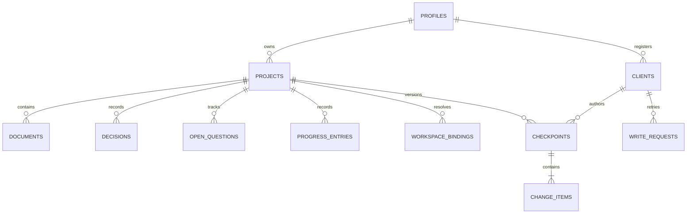

# PostgreSQL schema design — local MVP

Status: accepted MVP baseline, subject to refinement during implementation. This document is not an executed migration. Names, constraints, and transaction behavior below define the intended first migration and service contract. The API design introduces a proposed audit-metadata refinement noted below.

## Design decisions

1. One local profile owns many projects. No team/account/authentication schema in the MVP.
2. Documents contain readable Markdown. Feature plans and architecture are document kinds rather than hardcoded columns on a project.
3. Decisions, open questions, and progress have their own tables because they need distinct states and retrieval behavior.
4. The project is the consistency boundary: every project mutation advances one project revision. This deliberately favors simple, safe concurrency over simultaneous edits to unrelated sections.
5. Every committed mutation records a checkpoint and before/after snapshots in the same transaction. Current tables serve reads; history serves inspection and future restore support. This is not an event-sourced application.
6. UUID identifiers are generated by the Go service. All timestamps use `timestamptz`. Use explicit `NOT NULL` unless a field is marked nullable below. Text defaults to empty only where an empty value is meaningful.

## Relationships

There is no separate “memory” table. Project metadata, current documents, accepted decisions, unresolved questions, and progress collectively form memory. The Go service assembles a context packet from these records.

## Shared field rules

- All main tables have `id uuid PRIMARY KEY`.
- Content tables have `project_id uuid REFERENCES projects(id)`, `created_at timestamptz`, and `updated_at timestamptz`.
- Content tables also have `last_changed_revision bigint CHECK (> 0)`, identifying the project revision that last changed them. This is not an independent per-row revision counter.
- Reject blank titles/names using `CHECK (length(btrim(value)) > 0)` where required.
- Use text with `CHECK` constraints for small state vocabularies; avoid PostgreSQL enums for the initial schema.
- Project/content foreign keys use restrictive deletion. The MVP archives projects and does not expose hard deletion.
- Backend writes supply timestamps consistently. Updating a row does not automatically change its timestamp; repository methods must do so explicitly.

## 1. profiles

| Column | Type | Purpose |
| --- | --- | --- |
| id | uuid | Local profile identity |
| display_name | text | Required nonblank name |
| created_at | timestamptz | Creation time |

Bootstrap one profile on first setup. Multiple profile rows are structurally possible, but profile switching and multiple users are outside the MVP.

## 2. clients

| Column | Type | Purpose |
| --- | --- | --- |
| id | uuid | Configured client identity |
| profile_id | uuid FK profiles | Owning profile |
| kind | text | `dashboard`, `agent`, or `system` |
| name | text | Display name such as Codex or Claude |
| created_at | timestamptz | Registration time |
| revoked_at | timestamptz nullable | Disable future access without removing history |

Client identity is resolved by trusted local configuration/credentials. An arbitrary `client_id` or actor label in a request is not trusted. Names are attribution labels, not proof that a particular human approved a decision. Credential material is kept out of these domain tables; local credential provisioning is specified with API access control.

## 3. projects

| Column | Type | Purpose |
| --- | --- | --- |
| id | uuid | Stable identity and dashboard URL |
| profile_id | uuid FK profiles | Owner |
| title | text | Required nonblank title; not unique |
| summary | text | Short board/context description, default empty |
| next_step | text | Current concise next action, default empty |
| revision | bigint | Positive monotonic project revision, starts at 1 |
| archived_at | timestamptz nullable | Hide from active board |
| created_at, updated_at | timestamptz | Lifecycle and recent activity |

Do not use titles as identity or force titles to be unique. Similar ideas can be separate projects. Duplicate request prevention uses idempotency, not title matching. No Kanban status column.

## 4. documents

Shared content fields plus:

| Column | Type | Purpose |
| --- | --- | --- |
| kind | text | `overview`, `feature_plan`, `architecture`, or `note` |
| title | text | Required document title |
| content | text | Markdown body, default empty |
| state | text | `draft`, `accepted`, or `superseded` |

Use a partial unique index on `project_id` for `kind = 'overview'` to allow one overview per project. Other kinds allow multiple documents. The overview contains the problem, audience, solution, and scope as prose; do not duplicate these into a generic JSON blob.

Editing an accepted document resets it to draft unless the user explicitly accepts the updated content. Prior acceptance stays in history. This prevents an agent's new proposal from silently inheriting acceptance. The overview follows the same rule.

## 5. decisions

Shared content fields plus:

| Column | Type | Purpose |
| --- | --- | --- |
| title | text | Short decision name |
| statement | text | Required nonblank decision |
| rationale | text | Why, default empty |
| state | text | `proposed`, `accepted`, `rejected`, or `superseded` |
| source_reference | text nullable | Optional conversation/file/document reference |
| acceptance_reference | text nullable | Evidence of user agreement |

An accepted decision requires a nonblank acceptance reference. This is an evidence reference, not a cryptographic guarantee of agreement. The agent instructions and service rules govern transitions. Editing an accepted decision returns it to proposed; replacement can mark the old decision superseded and create a new one in the same checkpoint. Accepted decisions are never silently dropped during context assembly.

## 6. open_questions

Shared content fields plus:

| Column | Type | Purpose |
| --- | --- | --- |
| question | text | Required nonblank question |
| state | text | `open`, `resolved`, or `dismissed` |
| resolution | text nullable | Answer or reason for dismissing |

Constraint: open questions have no resolution; resolved/dismissed questions require a nonblank resolution. No separate boolean that could disagree with state.

## 7. progress_entries

Shared content fields plus:

| Column | Type | Purpose |
| --- | --- | --- |
| summary | text | Required nonblank outcome or handoff |
| verification | text | `reported` or `verified` |
| evidence | jsonb | Array of `{kind, reference, description}` objects; default `[]` |

Database constraints require an array and at least one item when verification is `verified`; Go validates each object's shape and reference. A verified label means evidence was supplied, not that the database ran a test. Entries describe actual outcomes, not planned work. Current next action lives in `projects.next_step`, with prior values preserved in history.

## 8. workspace_bindings

| Column | Type | Purpose |
| --- | --- | --- |
| id | uuid | Binding identity |
| project_id | uuid FK projects | Resolved project |
| workspace_key | text | Required canonical local absolute directory path |
| repository_url | text nullable | Optional repository metadata; not identity |
| created_at | timestamptz | Binding time |
| updated_at | timestamptz | Last binding change |
| last_changed_revision | bigint | Project revision of last change |

Unique `workspace_key` for this single-profile local installation. A workspace resolves to one project; a project can have several workspaces. The adapter canonicalizes paths on the agent machine before submitting them. Moving a directory requires rebinding. Reassignment across projects is deferred; remove and add bindings explicitly, with both changes audited.

## 9. checkpoints

| Column | Type | Purpose |
| --- | --- | --- |
| id | uuid | One atomic project mutation |
| project_id | uuid FK projects | Affected project |
| revision | bigint | Resulting project revision |
| client_id | uuid FK clients | Trusted writer |
| origin | text | `dashboard`, `mcp`, or `system` |
| summary | text | Required explanation of meaningful change |
| source_reference | text nullable | Optional source conversation/session reference |
| created_at | timestamptz | Commit event time |

Unique `(project_id, revision)`. Revision 1 records project creation. Checkpoints are append-only through the application; no update/delete endpoints. Client and project ownership must match, enforced by the service inside the transaction. Bindings and project metadata changes also create checkpoints.

## 10. change_items

| Column | Type | Purpose |
| --- | --- | --- |
| id | uuid | Change identity |
| checkpoint_id | uuid FK checkpoints | Parent transaction |
| ordinal | integer | Positive ordering inside checkpoint |
| entity_type | text | `project`, `document`, `decision`, `question`, `progress`, or `workspace_binding` |
| entity_id | uuid | Historical entity identity |
| operation | text | `create`, `update`, or `delete` |
| before_data | jsonb nullable | Full prior entity snapshot |
| after_data | jsonb nullable | Full resulting entity snapshot |
| metadata | jsonb | Object, default `{}`; validated audit annotations such as document acceptance reference |

Unique `(checkpoint_id, ordinal)` and `(checkpoint_id, entity_type, entity_id)`; consolidate multiple edits to one entity in a checkpoint. Require JSON objects when snapshots are present. Creation has only after-data, update has both, deletion has only before-data.

API-design refinement: `metadata` retains a document acceptance reference when the document is explicitly accepted. This is proposed alongside the API contract; the service accepts only known metadata fields and does not expose arbitrary metadata writes.

`entity_id` deliberately has no polymorphic foreign key: history must remain readable after an entity is removed. Go validates the target and its project when writing. Workspace-binding deletion is supported; content deletion is deferred in favor of superseding/resolving records. A future restore creates a new revision instead of rewriting old checkpoints. Full document snapshots are an intentional storage tradeoff for a small local MVP.

## 11. write_requests

| Column | Type | Purpose |
| --- | --- | --- |
| id | uuid | Request record |
| client_id | uuid FK clients | Idempotency namespace |
| idempotency_key | text | Required bounded caller-generated key |
| request_hash | text | Server hash of canonical operation, target, and validated payload |
| response_status | integer | Committed successful HTTP status |
| response_body | jsonb | Stable replay result |
| created_at | timestamptz | Commit time |

Unique `(client_id, idempotency_key)` across all write operations, including project creation. The stored result and domain changes commit atomically. Same key and hash returns the original result; same key with different input returns a conflict. Do not include secrets in stored responses. Retain request records throughout the MVP rather than allowing expired keys to cause surprise duplicates.

## Indexes and constraints

Besides primary keys and unique constraints:

- Active board: `projects(profile_id, updated_at DESC, id)` where `archived_at IS NULL`.
- Archived listing: corresponding partial index where `archived_at IS NOT NULL`.
- Document listing: `documents(project_id, kind, updated_at DESC, id)`.
- Context: `decisions(project_id, state)`, `open_questions(project_id, state)`, and `progress_entries(project_id, created_at DESC, id)`.
- Timeline: unique checkpoint index `(project_id, revision)` supports ordered history reads.
- Index `clients(profile_id)` and `checkpoints(client_id)` for ownership/attribution queries. Unique request and change-item indexes cover their parent lookup prefixes.
- Initial search uses parameterized case-insensitive title/summary matching. Specialized text-search extensions and indexes are deferred until justified by volume.
- Positive revisions and ordinals, allowed states, JSON container types, and nonblank required text are database checks.
- Cross-table ownership, legal state transitions, and evidence object validation are service rules. Foreign keys alone do not enforce them.

## Atomic update protocol

1. Resolve the trusted client and configured profile. Validate payload size and schema.
2. Begin a transaction. Serialize equal `(client_id, idempotency_key)` requests using a transaction-scoped advisory lock derived from that pair. A hash collision only serializes unrelated requests; the unique key remains the correctness check.
3. If a committed request exists, compare its hash and replay or reject. Check this before revision validation so a successful retry does not look stale.
4. For an existing project, lock its row with `SELECT ... FOR UPDATE`, verify ownership/archive rules, and compare `expected_revision`. Reject a mismatch with HTTP 409 and the current revision.
5. Apply all validated changes, increment the project revision once, update activity time, and stamp affected rows with that revision. Project creation starts at revision 1.
6. Insert exactly one checkpoint and its change items, including the project's before/after metadata snapshot. Insert the replay response in `write_requests`.
7. Commit. On failure, roll everything back. Return only after the transaction commits.

All project writers use this protocol, including dashboard edits. It prevents silent overwrites without automatically merging conflicting prose. Metadata changes also invalidate older project revisions, a deliberate MVP simplification. Multi-project mutations are outside this protocol and MVP scope.

## Consistent context reads

Assemble each context packet in one read-only repeatable-read transaction so its multiple queries share one snapshot. Return the project revision and document references with the packet. Include the overview, current next step, accepted decisions, unresolved questions, and a bounded recent progress window. Return counts and continuation references whenever content is truncated; fetch full documents separately. Do not persist another independently editable summary of the entire memory.

The transaction choices follow PostgreSQL's documented snapshot and locking behavior: [transaction isolation](https://www.postgresql.org/docs/current/transaction-iso.html). Implementation must handle transaction failures and test concurrent reads/writes against a real PostgreSQL instance.

## Example evolution of this project

1. Explicit capture creates a project, overview document, and revision-1 checkpoint in one transaction.
2. Choosing local deployment and the stack records accepted decisions with conversation references at revision 2.
3. Drafting phases and architecture adds documents at revision 3; drafting them does not mark implementation complete.
4. A dashboard edit based on revision 3 succeeds as revision 4.
5. An agent trying to save against revision 3 receives a conflict, reloads revision 4, and reconciles before writing.

## Deferred schema

No embeddings, chat-message archive, organizations, project memberships, generic task graph, synchronization log, or external deployment credentials. Feature plans can describe phases as Markdown; dedicated phase/task tables should only be introduced if structured execution tracking becomes a product requirement.
