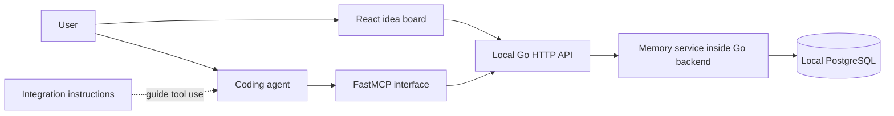

# Project Idea Memory — MVP design draft

Status: proposed design for discussion, not an implementation commitment.

Related planning documents: [implementation phases](implementation-phases.md) and [PostgreSQL schema design](database-schema.md). The schema document refines the minimal data model below and defines concurrency/history behavior.

API contract draft: [HTTP API and matching MCP tools](api-design.md).

## Purpose

Give each project idea a lasting home that grows from an initial discussion into feature plans, architecture, and implementation context. Users browse an idea board; coding agents retrieve and maintain the same project memory through MCP.

## Agreed product direction

- Tracking starts explicitly: “track this project,” “save this idea,” or an equivalent dashboard action.
- The primary experience is an idea board with project cards, not a Kanban workflow.
- Each card opens a project workspace with readable documents and supporting metadata.
- Connected agents can maintain tracked projects during subsequent work and resume context across sessions.
- The MVP runs locally and supports offline dashboard and memory operations. Hosted and hybrid deployment are future options.
- Automatic discovery of untracked ideas is outside the MVP.

## Proposed MVP boundaries

- One owner/profile with many projects; collaboration and organization roles come later.
- One configured memory service per agent connection; no offline synchronization between separate services.
- Core workspace sections: overview, feature plans, architecture, decisions, open questions, and progress/next steps.
- Documents remain editable prose. Decisions, questions, and changes have stable identifiers and metadata.
- No task dependency engine, mandatory stages, autonomous coding, repository indexing, or full chat archive.
- A project may have a repository association, but an idea does not require a repository.

## User flow

### 1. Connect once

The user starts the local application and PostgreSQL instance. They configure the coding agent's MCP connection and install or enable accompanying agent instructions where supported. The dashboard and agent connect to the same local Go API. Local access must be limited to its intended user and interface.

Offline means the dashboard, API, MCP interface, and stored memory do not require a cloud service at runtime after installation. A connected coding agent may independently require internet access for its model; this application does not supply an offline model. Installation and dependency downloads are separate from offline operation.

The plugin-like experience is packaging around MCP configuration and agent instructions. MCP exposes operations; instructions explain when to call them. Exact installation packaging depends on each agent host and must be validated before implementation.

### 2. Start naturally

The user discusses an idea in their coding agent without creating a project first. Nothing is saved automatically to this service during an untracked discussion.

### 3. Explicitly capture

When the user says “track this project,” the agent uses the available conversation to draft a title, idea summary, problem, audience, known requirements, and open questions. Unknown details remain unknown. The agent searches for a likely existing project before creating one. If the match is ambiguous, it asks the user to choose.

Creation returns a stable project ID and dashboard link. The agent reports what was captured. Explicit capture authorizes creating the profile without a second approval step.

### 4. Develop the idea

The user continues: “let's plan features” or “create the architecture.” The agent reads existing memory, works through the request, and saves the resulting document or scoped updates. Draft proposals are labeled as proposals; user agreement is recorded separately from agent suggestions.

### 5. Browse and edit

The board displays a title, short summary, last updated time, and a small next-step preview for each project. Users can search and open cards. Inside a project, they can read and edit sections, inspect change history, and archive an idea. No stage transition is required.

### 6. Resume

In a later session, the user says “continue this project.” The agent resolves the project using an explicit selection or saved workspace binding. It loads a compact context packet containing the current summary, scope, accepted decisions, relevant documents, unresolved questions, and next steps. A binding is a pointer, not a separate copy of project memory.

## Agent flow

1. Resolve the configured service and authenticated owner.
2. Resolve the project: explicit ID/selection, workspace binding, or search. Never silently select among ambiguous matches.
3. If untracked, create only after an explicit capture request.
4. Read current context and revision before making a meaningful update.
5. Carry out the user's planning or development request.
6. Save meaningful outcomes at a natural checkpoint, rather than every message or token.
7. Include source, author, proposal/acceptance state, and expected revision.
8. On a revision conflict, fetch changes and reconcile; ask the user only when the competing changes require a decision.
9. Confirm saved outcomes and expose a dashboard link when useful. If saving fails, report that persistence failed; do not imply the memory is current.

Natural checkpoints include an agreed feature scope, a completed architecture draft, a changed decision, a verified implementation milestone, or a session handoff. The service does not listen to conversations independently: updates depend on agent tool calls. The integration instructions encourage these calls, but uninterrupted capture is not guaranteed.

## Memory rules

- Current documents describe current understanding; history preserves previous revisions.
- Separate proposed features and decisions from accepted scope and decisions.
- Record implementation claims with available evidence, such as a file reference, commit, or test outcome. An agent's plan is not evidence of completion.
- Save useful distilled context, not entire conversations by default.
- Record actor, origin, timestamp, and a short reason with each change. Origin may be dashboard, Codex, Claude, or another client; actor identity comes from credentials rather than an unverified label.
- Store structured state in the database and return a compact context packet derived from it. No vector database is required for the initial scope.
- Use revision checks for concurrent edits and idempotency keys for retried writes.
- Do not store credentials or secrets inside project documents.

## System architecture

The Go backend contains both the HTTP API and memory service. FastMCP is a separate adapter process that calls this API. Both dashboard edits and agent updates pass through the same Go validation and persistence logic. FastMCP does not access PostgreSQL directly.

### Selected stack and proposed local runtime

- **MCP interface: FastMCP**, in a separate adapter process. The implementation language/package version and transport will be pinned when implementation begins.
- **API and memory service: Go**, with HTTP endpoints shared by the dashboard and MCP adapter.
- **Frontend: React**. Proposed baseline: a client-rendered app with a static production build served by Go. Next.js remains optional if a concrete requirement warrants it.
- **Database: PostgreSQL**, running locally with durable storage outside disposable application processes.
- **Local networking:** bind application endpoints to loopback by default. Keep database credentials in backend configuration. Validate browser origins and protect write requests against unintended browser access.
- **Offline assets:** bundle dashboard scripts, styles, fonts, and other required assets locally; no runtime CDN dependency.
- **Packaging:** Docker Compose runs local PostgreSQL for development; Go runs directly on the Mac. Native PostgreSQL remains an alternative. Setup/run commands are documented in the root README. A unified launcher and backup/restore commands remain future implementation work.

The proposed frontend baseline avoids adding a separate frontend production server. This is an architecture proposal, not a finalized frontend tooling choice.

### Responsibilities

| Component | Responsibility |
| --- | --- |
| Agent integration | Connection setup, explicit capture behavior, project binding, retrieval and checkpoint instructions |
| FastMCP interface | Expose project operations to coding agents and translate requests into Go HTTP API calls |
| Dashboard | Render the idea board, project sections, editing, and history |
| Dashboard API | Authenticated operations for the dashboard |
| Memory service | Project identity, validation, permissions, revisions, context assembly, and consistent updates |
| Database | Persist current project data and change history |

The dashboard and MCP interface use the same API and memory service. Neither has a separate source of truth. Writes to current content and its history should commit together in PostgreSQL transactions.

## Minimal data model

| Entity | Main fields |
| --- | --- |
| Profile | id, display name |
| Project | id, owner id, title, summary, archived at, revision, timestamps |
| Document | id, project id, section/type, title, content, draft/accepted state, revision |
| Decision | id, project id, statement, rationale, proposed/accepted/superseded state, related references |
| Open question | id, project id, question, resolution state, resolution |
| Progress entry | id, project id, outcome, evidence references, next steps |
| Change record | id, project id, target, actor, origin, revision, reason, recoverable prior content or change data, timestamp |
| Workspace binding | owner id, workspace/repository reference, project id |

Feature plans and architecture are document types, so an idea can grow into multiple plans without database schema changes. Small project metadata supports browsing. Archived projects remain recoverable.

## Proposed MCP surface

Names and request schemas are provisional.

| Tool | Purpose |
| --- | --- |
| `list_projects` | Browse or search the owner's projects |
| `create_project` | Capture an explicitly selected idea; accept initial content and an idempotency key |
| `get_project_context` | Retrieve compact current memory, relevant document references, and revisions |
| `get_document` | Retrieve a full document when compact context is insufficient |
| `apply_project_update` | Atomically apply scoped document/decision/question/progress changes with expected revisions and provenance |
| `get_project_history` | Inspect previous changes and their sources |
| `bind_workspace` | Associate a workspace/repository with an existing project |

Read and update tools must validate project ownership. An update must specify its target; vague free-form instructions should not be interpreted as arbitrary database mutations. The dashboard may use additional internal endpoints for archiving and history restoration.

## Deployment modes

| Mode | Placement |
| --- | --- |
| Local | Dashboard, backend/MCP interface, and database run on the user's machine |
| Hosted | Dashboard, backend/MCP interface, and database run remotely; agents authenticate to the service |
| Hybrid | Backend/MCP interface and dashboard run locally; database is remote and accessed only by the backend |

**Selected MVP mode: local.** Hosted and hybrid modes are deferred. Keep database access behind the Go service's persistence boundary so deployment location can change later. Synchronization between separate local and hosted databases is outside the MVP; local offline operation uses its own local PostgreSQL database directly.

## Failure and concurrency behavior

- Retrying a successful create/write with the same idempotency key must not duplicate it.
- Concurrent dashboard and agent edits must produce a revision conflict rather than silently overwrite content.
- Failed saves must leave current data and history consistent.
- Failed agent sessions retain all previously committed checkpoints.
- Retrieval should disclose missing or stale information; agents should not invent prior decisions.
- Archiving hides a project from the default board but preserves memory.

## MVP acceptance walkthrough

1. Discuss an idea with one connected agent and explicitly track it.
2. See exactly one project card with the captured summary and open questions.
3. Produce a feature plan and architecture draft; see both in the same workspace.
4. Manually edit a section in the dashboard; confirm the next agent read includes the edit.
5. Resume from a fresh agent session and retrieve current scope, decisions, and next steps.
6. Connect another supported agent and retrieve the same project without duplicating it.
7. Retry a write and simulate conflicting edits; verify deduplication and conflict handling.
8. With external network access unavailable, verify dashboard browsing, editing, history, and direct MCP tool operations against the local API. Test agent behavior separately according to its model connectivity requirements.

## Decisions to make next

1. First supported agent and installation experience; then validate the second agent.
2. FastMCP package/language choice and agent connection transport.
3. A unified local startup experience; PostgreSQL setup and live foundation verification are complete using Docker Compose.
4. Dashboard editing depth: basic text/Markdown editing is the proposed MVP baseline.
5. Confirm the proposed React static frontend, local access controls, and backup/restore workflow.

## Suggested implementation sequence

1. Project storage and memory service with revisioned writes.
2. MCP capture and context retrieval; prove a complete capture/resume loop.
3. Idea board and project workspace using the same service.
4. Agent checkpoint instructions, dashboard editing, and history.
5. Validate the second agent, persistence failure cases, and the chosen deployment package.
